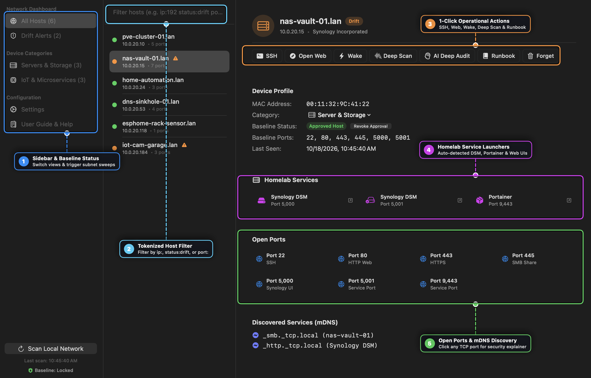
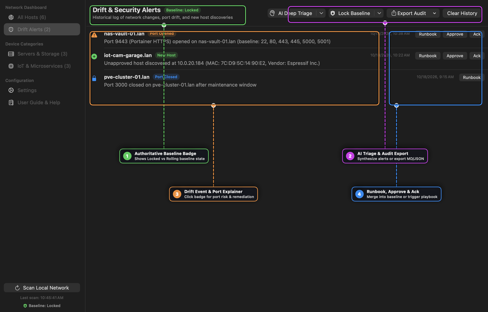
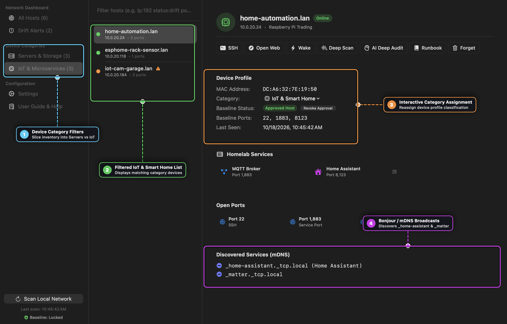

# Drifter User Guide

Welcome to **Drifter**! This guide covers everything you need to know to monitor local network hosts, audit port drift, launch SSH sessions with 1Password Touch ID, and trigger automated Runbook workflows.

---

## Table of Contents

1. [Overview](#1-overview)
2. [Getting Started & Local Network Access](#2-getting-started--local-network-access)
3. [Network Discovery & Authoritative Baselining](#3-network-discovery--authoritative-baselining)
4. [Searching & Filtering Hosts](#4-searching--filtering-hosts)
5. [SSH Terminal & 1Password Touch ID Integration](#5-ssh-terminal--1password-touch-id-integration)
6. [Runbook Automation Integration](#6-runbook-automation-integration)
7. [Deep Port Probing, Wake-on-LAN & Homelab Services](#7-deep-port-probing-wake-on-lan--homelab-services)
8. [Menu Bar Status Item & Background Watchdog](#8-menu-bar-status-item--background-watchdog)
9. [Exporting Network Security Audit Reports](#9-exporting-network-security-audit-reports)
10. [Optional AI Security Advisor](#10-optional-ai-security-advisor)
11. [Settings & Customization](#11-settings--customization)
12. [Data Storage & Privacy](#12-data-storage--privacy)

---

## 1. Overview

Drifter is a native macOS application designed for home lab enthusiasts, DevOps engineers, and network administrators who want **real-time visibility over local network devices** without subscription bloat or cloud dependencies.

Drifter continuously monitors your local subnet to track:
- **New Hosts**: Devices that join your local network.
- **Port Drift**: Open ports that appear or disappear on hosts.
- **mDNS Services**: Broadcast services like Home Assistant (`_home-assistant._tcp`) or HTTP Web (`_http._tcp`).

---

## 2. Getting Started & Local Network Access

When you launch Drifter for the first time:
1. **Local Network Access**: macOS 14/15 will ask for permission to scan your local network. Click **Allow** to enable ARP and mDNS discovery.
2. **Initial Subnet Scan**: If your host list is empty, Drifter automatically triggers a subnet scan using your Mac's ARP table.
3. **Manual Scan**: Click **Scan Local Network** at the bottom of the sidebar at any time to run an instant scan.



---

## 3. Network Discovery & Authoritative Baselining

### How Discovery Works
- **Subnet ARP Sweeping**: Automatically detects your active IPv4 subnet (e.g. `10.0.20.0/24`) and dispatches concurrent, non-blocking UDP probes to warm the macOS kernel ARP cache before querying `/usr/sbin/arp -a`.
- **Port Probing**: Checks common infrastructure ports (`22` SSH, `53` DNS, `80` HTTP, `443` HTTPS, `8123` Home Assistant, `8080` Web Alt, `5000` Synology).
- **Native Bonjour Discovery (`NWBrowser`)**: Actively queries Zeroconf/Bonjour broadcasts to identify service names and device categories (`_home-assistant`, `_esphomelib`, `_matter`, `_smb`, `_airplay`, `_printer`).
- **Expanded Hardware OUI Lookup**: Maps MAC addresses to hardware vendors including Logitech (Harmony Hub, remotes), Roku, Smart TVs (Samsung, LG, Sony), Espressif (ESP32/ESP8266), Raspberry Pi, Ubiquiti, Synology, Tuya, Sonoff, Philips Hue, Intel, Dell, Netgear, TP-Link, Sonos, Shelly, LIFX, Broadlink, Lutron, Wyze, Eufy, Roborock, Meross, Chamberlain/myQ, Withings, Nanoleaf, Belkin/Wemo, Cisco, ASUS, Amazon Eero, and network printers (HP, Brother, Epson, Canon).

### Authoritative Baseline Evolution
Drifter provides an authoritative baseline model:
1. **Bless All & Lock Baseline**: In initial rolling discovery mode (`Baseline: Rolling`), a banner appears above the alert list with a **Bless All (N)** action. Clicking it snapshots all active hosts and ports into the authoritative baseline AND marks all active initial discovery alerts as resolved in a single click.
2. **Lock Baseline**: Click **Lock Baseline** in Drift Alerts or Settings to snapshot the entire current network state (all known hosts and open ports) as the authoritative gold master without modifying alert statuses.
3. **Incremental "Approve into Baseline"**: When legitimate changes occur (e.g. you spin up a new container on port 8006 or add a new device), click **Approve** on the alert card or right-click to approve. This merges the change directly into that host's baseline without needing to reset or rebuild the rest of the network.
4. **Rogue Host Detection**: If an unknown device joins an established network baseline, it is immediately flagged as `🔴 Unapproved / Rogue` with a drift alert.

### Right-Click Alert Context Menus
Right-click any alert row in **Drift Alerts** to reveal native macOS workflow actions:
- **AI Security Advisor**: Trigger a **Deep Security Investigation** or **Quick Triage** targeting that specific alert and host.
- **Host Navigation**: Jump directly to **View Host in Inventory** with the device pre-selected.
- **Service Launchers**: **Open Web Interface** (detects open HTTP/HTTPS/8080/8123 ports), **Launch SSH Session** in your preferred terminal, or trigger **Runbook Triage**.
- **Alert Resolution**: **Approve into Baseline**, **Acknowledge Alert**, or **Dismiss Alert** (`trash`).
- **Clipboard Helpers**: Copy IP address, hostname, or timestamped log details.

### Drift Alerting
Whenever Drifter detects a structural change (new open port, closed port, IP lease change, or unapproved host), it generates a **Drift Alert**. Drift alerts appear in:
- The **Drift Alerts** tab in the main sidebar.
- The macOS **Menu Bar** icon badge.
- Native macOS desktop notifications (when enabled).



---

## 4. Searching & Filtering Hosts

Drifter includes an AppKit-backed search bar with **tokenized filter support**:

| Search Query | Filter Action |
| :--- | :--- |
| `ip:10.0.20.` | Filter hosts matching IP subnet `10.0.20.*` |
| `dns-sinkhole` | Filter hosts by hostname |
| `port:22` | Show hosts with SSH port 22 open |
| `status:drift` | Show hosts with active drift alerts |
| `synology` | Filter hosts by hardware vendor or hostname |

You can also use the sidebar categories (**Servers & Storage**, **IoT & Microservices**) to filter hosts by device type.

### Interactive Device Categorization
Drifter automatically categorizes devices using vendor signatures, hostname keywords, mDNS broadcasts, and open service ports. You can also manually re-assign any device's category:
1. Select the host in the inventory list.
2. In the **Device Profile** section, click the **Category** dropdown menu.
3. Choose from **Server & Storage**, **IoT & Smart Home**, **Workstation & PC**, **Network Infrastructure**, or **Unknown**.
4. The change persists immediately and updates the sidebar category counters.



---

## 5. SSH Terminal & 1Password Touch ID Integration

### One-Click SSH Launch
Clicking the **SSH** button on any host card launches a terminal window directly connected to that device.

### Automatic `~/.ssh/config` Resolution
Drifter automatically parses your `~/.ssh/config` file to resolve Host aliases and IP mappings:
- If `10.0.20.53` is mapped to `Host dns-sinkhole` in `~/.ssh/config`, Drifter executes `ssh dns-sinkhole`.
- OpenSSH automatically applies your configured `User`, `Port`, `IdentityFile`, and `IdentityAgent`.

### 1Password Touch ID Support
If you use 1Password for SSH key management, Drifter automatically exports `SSH_AUTH_SOCK` (`~/Library/Group Containers/2BUA8C4S2C.com.1password/t/agent.sock`), prompting your **macOS Touch ID fingerprint** when connecting.

### Supported Terminals
In **Settings**, pick your preferred terminal:
- **Ghostty** (Default)
- **Apple Terminal**
- **iTerm2**
- **Custom Command Template** (e.g. `ghostty -e ssh {target}`)

---

## 6. Runbook Automation Integration

Drifter integrates directly with [Runbook](https://github.com/msjurset/runbook-mac) for one-click incident response and automated health checks.

### Triggering a Runbook
- Click **Runbook** on any host detail card or Drift Alert card.
- Drifter constructs a parameterized deep-link:
  ```
  runbook://execute?template=security-audit&host=10.0.20.15
  ```
- Runbook opens directly and pre-selects the relevant audit procedure with variables pre-filled.

### Pre-Installed Integration Templates
Drifter ships with two starter runbooks (stored in `~/.runbook/books/`):
- **`security-audit.yaml`**: Inspects open ports, firewall status (`ufw`/`iptables`), active SSH sessions, and failed login attempts.
- **`network-triage.yaml`**: Performs ping reachability tests, common port probes, and HTTP response header checks.

---

---

## 7. Deep Port Probing, Wake-on-LAN & Homelab Services

### On-Demand Deep Port Probing
While general subnet sweeps test 7 common infrastructure ports to ensure instant scan times, clicking **Deep Scan** on any host detail card runs a high-speed concurrent probe of 23 common homelab, infrastructure, and database ports (`8006, 9000, 9443, 32400, 8123, 8096, 3000, 9090, 5000, 5001, 8443, 1883, 5432, 6379`, etc.).

### Homelab Service Detection & Web Launchers
When Drifter discovers known homelab microservices, it populates direct 1-click launcher badges on the host card:
- **Proxmox VE** (`https://{ip}:8006`)
- **Portainer** (`https://{ip}:9443` or `http://{ip}:9000`)
- **Home Assistant** (`http://{ip}:8123`)
- **Plex Media Server** (`http://{ip}:32400/web`)
- **Jellyfin** (`http://{ip}:8096`)
- **Cockpit** (`https://{ip}:9090`)
- **Grafana** (`http://{ip}:3000`)
- **Synology DSM** (`http://{ip}:5000` / `https://{ip}:5001`)

### Wake-on-LAN (WoL)
For offline or sleeping hosts with a recorded MAC address, click the **Wake** button in the header action bar. Drifter transmits a standard UDP broadcast magic packet (`0xFF * 6` + `MAC * 16`) across ports 9 and 7 to remotely power on the machine.

---

## 8. Menu Bar Status Item & Background Watchdog

Drifter features an unobtrusive macOS status item in the menu bar (`waveform.path.ecg` or `exclamationmark.shield.fill` icon):
- **Left-Click**: Instantly toggles the main Drifter dashboard window (brings to front or hides).
- **Right-Click Context Menu**:
  - **Live Status & Drift Alerts**: Shows current watchdog polling status and a preview of up to 5 active drift alerts.
  - **Show Main Window**: Brings the dashboard forward.
  - **Scan Subnet Now**: Kicks off an immediate subnet ARP sweep and port scan.
  - **Lock Baseline Now**: Locks the current network inventory as the authoritative baseline.
  - **Export Audit Report...**: Exports a Markdown report directly to disk.
  - **Restart**: Safely exits and relaunches Drifter.app in place.
  - **Quit**: Closes the application.
- **Background Watchdog**: Automatically polls the local subnet in the background (configured in Settings: *Every 5m, 15m, 30m, 1h*, or *Manual Only*). Runs entirely within the application process with no external daemon required.
- **Show/Hide Toggle**: Can be enabled or disabled at any time under **Settings > Show Menu Bar Watchdog Item**.

---

## 9. Exporting Network Security Audit Reports

Generate comprehensive network baseline and compliance reports at any time by clicking **Export Audit** in the Drift Alerts tab or Settings:
- **Markdown (`.md`)**: A formatted GitHub Flavored Markdown document containing executive metrics (compliance %, rogue host count, port drift divergence), host inventory matrix, and unacknowledged security alerts.
- **JSON (`.json`)**: A machine-readable export suitable for CI/CD pipelines, SIEM ingest, or homelab GitOps version control.
- **Clipboard**: Copy formatted Markdown directly to the macOS clipboard for pasting into GitHub Issues, Obsidian, or Notion.

---

## 10. Optional AI Security Advisor

Drifter includes an **optional, purely additive AI Security Advisor**. It is disabled by default; when toggled off in Settings, all AI buttons and cards remain completely hidden so the application functions 100% offline with zero distractions.

### Supported Providers
- **Ollama (100% Local & Private)**:
  - Connects to your local Ollama daemon (`http://localhost:11434`).
  - Default model: `llama3.2`.
  - Zero cloud telemetry; no network packets or host data leave your workstation.
- **Cloud BYOK (Bring Your Own Key)**:
  - **Google Gemini**: Default `gemini-2.5-flash`
  - **Anthropic Claude**: Default `claude-3-5-haiku-latest`
  - **OpenAI**: Default `gpt-4o-mini`
  - **1Password Secret References**: Supports `op://vault/item/credential` URI syntax with local in-memory caching and Touch ID authentication.

### Capabilities & Usage
1. **Fast Triage vs. Deep Security Reasoning**:
   - **Fast Triage (~1s)**: Fast synthesis with compact token limits for quick, high-level homelab review.
   - **Deep Security Reasoning**: Extended multi-pass threat modeling (up to 4,096 tokens) with adversarial threat evaluation, lateral movement inspection, and hardware-specific attack surface analysis.
   - Any fast brief can be escalated to Deep Reasoning in one click.
2. **Drift Incident Triage**:
   - In the **Drift Alerts** tab, click **AI Triage** (or select **Deep Security Investigation** from the dropdown menu).
   - Generates an instant **Security Brief** card with classification, synthesis, and actionable terminal commands.
3. **Targeted Alert Investigation**:
   - Right-click any alert row in **Drift Alerts** and select **Deep Security Investigation** to run an isolated, in-depth threat audit targeting that specific host and event.
4. **Host Security Audit**:
   - On any host detail card, click **AI Audit** in the action bar (or select Deep Audit from the dropdown).
5. **Connection Verification**:
   - In **Settings > AI Security Advisor**, click **Test Connection** to immediately verify your local Ollama instance or cloud API key.

---

## 11. Settings & Customization

Navigate to **Settings** in the sidebar to configure:
- **Preferred Terminal Application**: Select Ghostty, Apple Terminal, iTerm2, or a custom launch command template.
- **Default SSH Username**: Set a default username for SSH connections (if not defined in `~/.ssh/config`).
- **Runbook URL Template**: Customize the deep-link query format.
- **Background Watchdog Polling**: Select background scan frequency (Manual Only, 5 min, 15 min, 30 min, 1 hour).
- **Baseline Management**: Snapshot and lock current state as the authoritative baseline.
- **Drift Alert Notifications**: Enable or disable macOS desktop notifications.
- **AI Security Advisor**: Enable optional local Ollama or cloud BYOK security analysis.


---

## 12. Data Storage & Privacy

Drifter is **100% local and offline** by default. No telemetry or host data ever leaves your Mac.
- **Local Store Location**: `~/Library/Application Support/DrifterMac/drifter_store.json`
- **Forgetting Hosts**: Click the **Forget** (🗑️) button on any host card to permanently delete a host baseline from your local store.
- **AI Privacy**: If the optional AI Advisor is enabled with Ollama, queries execute strictly against your local machine. If configured with a cloud provider, payloads contain only minimal host and port identifiers needed for the specific on-demand analysis.

