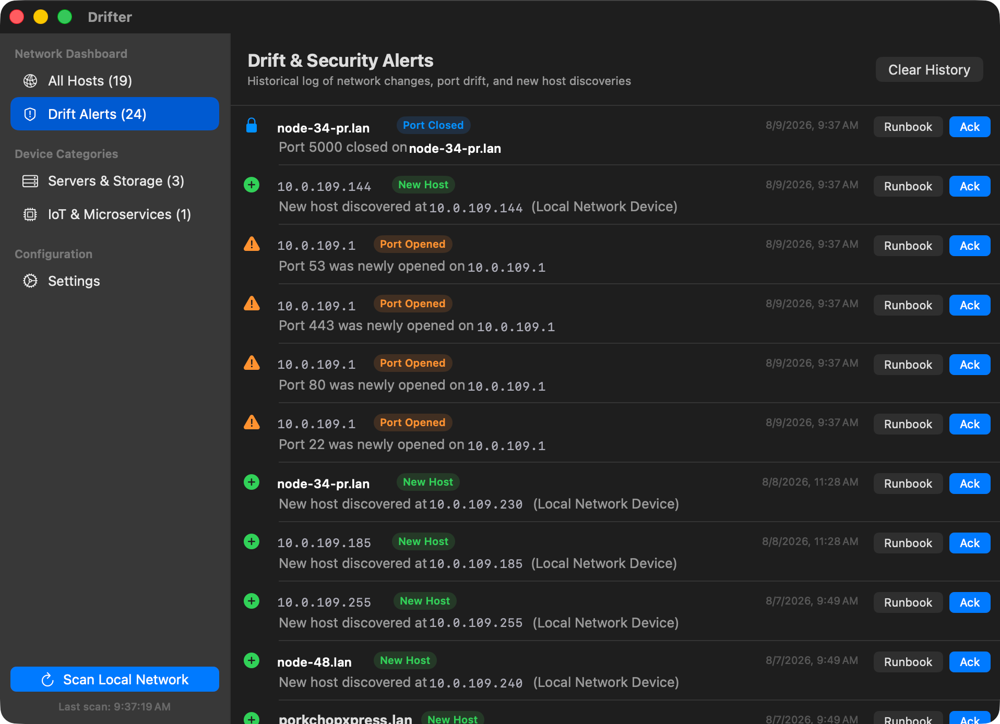
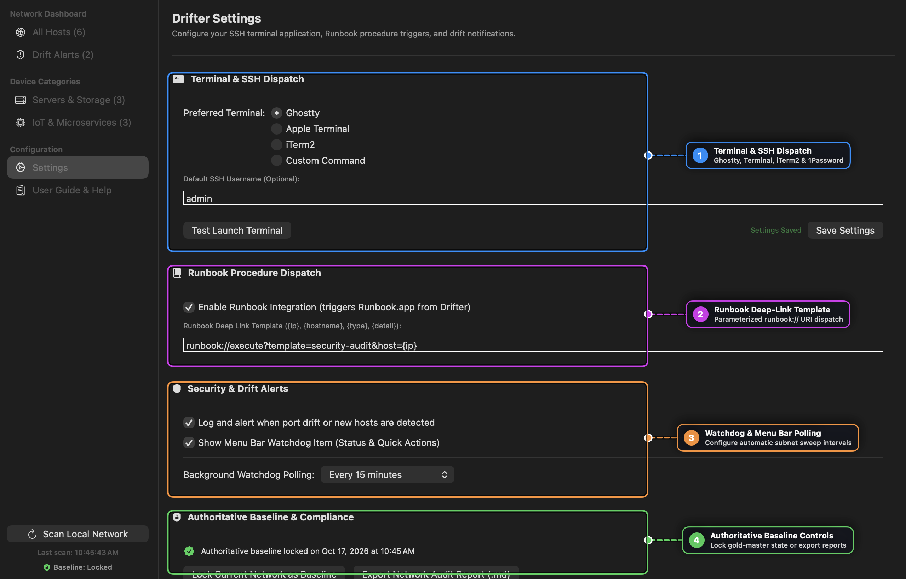

# Drifter User Guide

Welcome to **Drifter**! This guide covers everything you need to know to monitor local network hosts, audit port drift, launch SSH sessions with 1Password Touch ID, and trigger automated Runbook workflows.

---

## Table of Contents

1. [Overview](#1-overview)
2. [Getting Started & Local Network Access](#2-getting-started--local-network-access)
3. [Network Discovery & Port Drift Auditing](#3-network-discovery--port-drift-auditing)
4. [Searching & Filtering Hosts](#4-searching--filtering-hosts)
5. [SSH Terminal & 1Password Touch ID Integration](#5-ssh-terminal--1password-touch-id-integration)
6. [Runbook Automation Integration](#6-runbook-automation-integration)
7. [Menu Bar Status Item](#7-menu-bar-status-item)
8. [Settings & Customization](#8-settings--customization)
9. [Data Storage & Privacy](#9-data-storage--privacy)

---

## 1. Overview

Drifter is a native macOS application designed for home lab enthusiasts, DevOps engineers, and network administrators who want **real-time visibility over local network devices** without subscription bloat or cloud dependencies.

Drifter continuously monitors your local subnet to track:
- **New Hosts**: Devices that join your local network.
- **Port Drift**: Open ports that appear or disappear on hosts.
- **mDNS Services**: Broadcast services like Home Assistant (`_home-assistant._tcp`) or HTTP Web (`_http._tcp`).

---

## 2. Getting Started & Local Network Access

When you launch Drifter for the first time:
1. **Local Network Access**: macOS 14/15 will ask for permission to scan your local network. Click **Allow** to enable ARP and mDNS discovery.
2. **Initial Subnet Scan**: If your host list is empty, Drifter automatically triggers a subnet scan using your Mac's ARP table.
3. **Manual Scan**: Click **Scan Local Network** at the bottom of the sidebar at any time to run an instant scan.


<p align="right"><sub><em>Image anonymized by <a href="https://github.com/msjurset/anonymark">msjurset/anonymark</a></em></sub></p>

---

## 3. Network Discovery & Port Drift Auditing

### How Discovery Works
- **ARP Table Parsing**: Scans active IP/MAC bindings on your local subnet (e.g. `192.168.86.0/24`).
- **Port Probing**: Checks common infrastructure ports (`22` SSH, `53` DNS, `80` HTTP, `443` HTTPS, `8123` Home Assistant, `8080` Web Alt, `5000` Synology).
- **mDNS Multicast**: Listens for Zeroconf/Bonjour broadcasts to identify service names and device categories.

### Drift Alerting
Whenever Drifter detects a structural change (such as port 22 or port 80 opening on a host that previously had no open ports), it generates a **Drift Alert**. Drift alerts appear in:
- The **Drift Alerts** tab in the main sidebar.
- The macOS **Menu Bar** icon badge.


<p align="right"><sub><em>Image anonymized by <a href="https://github.com/msjurset/anonymark">msjurset/anonymark</a></em></sub></p>

---

## 4. Searching & Filtering Hosts

Drifter includes an AppKit-backed search bar with **tokenized filter support**:

| Search Query | Filter Action |
| :--- | :--- |
| `192.168.86.` | Filter hosts matching IP subnet `192.168.86.*` |
| `pi.hole` | Filter hosts by hostname |
| `port:22` | Show hosts with SSH port 22 open |
| `status:drift` | Show hosts with active drift alerts |
| `vendor:raspberry` | Filter hosts manufactured by Raspberry Pi |

You can also use the sidebar categories (**Servers & Storage**, **IoT & Microservices**) to filter hosts by device type.


<p align="right"><sub><em>Image anonymized by <a href="https://github.com/msjurset/anonymark">msjurset/anonymark</a></em></sub></p>

---

## 5. SSH Terminal & 1Password Touch ID Integration

### One-Click SSH Launch
Clicking the **SSH** button on any host card launches a terminal window directly connected to that device.

### Automatic `~/.ssh/config` Resolution
Drifter automatically parses your `~/.ssh/config` file to resolve Host aliases and IP mappings:
- If `192.168.86.55` is mapped to `Host pi-hole` in `~/.ssh/config`, Drifter executes `ssh pi-hole`.
- OpenSSH automatically applies your configured `User`, `Port`, `IdentityFile`, and `IdentityAgent`.

### 1Password Touch ID Support
If you use 1Password for SSH key management, Drifter automatically exports `SSH_AUTH_SOCK` (`~/Library/Group Containers/2BUA8C4S2C.com.1password/t/agent.sock`), prompting your **macOS Touch ID fingerprint** when connecting.

### Supported Terminals
In **Settings**, pick your preferred terminal:
- **Ghostty** (Default)
- **Apple Terminal**
- **iTerm2**
- **Custom Command Template** (e.g. `ghostty -e ssh {target}`)

---

## 6. Runbook Automation Integration

Drifter integrates directly with [Runbook](https://github.com/msjurset/runbook-mac) for one-click incident response and automated health checks.

### Triggering a Runbook
- Click **Runbook** on any host detail card or Drift Alert card.
- Drifter constructs a parameterized deep-link:
  ```
  runbook://execute?template=security-audit&host=192.168.86.55
  ```
- Runbook opens directly and pre-selects the relevant audit procedure with variables pre-filled.

### Pre-Installed Integration Templates
Drifter ships with two starter runbooks (stored in `~/.runbook/books/`):
- **`security-audit.yaml`**: Inspects open ports, firewall status (`ufw`/`iptables`), active SSH sessions, and failed login attempts.
- **`network-triage.yaml`**: Performs ping reachability tests, common port probes, and HTTP response header checks.

---

## 7. Menu Bar Status Item

Drifter runs an unobtrusive macOS status item in the menu bar (`waveform.path.ecg` icon):
- Displays the current number of active drift alerts.
- Provides a quick menu to trigger network scans or open specific host details.

---

## 8. Settings & Customization

Navigate to **Settings** in the sidebar to configure:
- **Preferred Terminal Application**: Select Ghostty, Apple Terminal, iTerm2, or a custom launch command.
- **Default SSH Username**: Set a default username for SSH connections (if not defined in `~/.ssh/config`).
- **Runbook URL Template**: Customize the deep-link query format.
- **Drift Alert Notifications**: Enable or disable macOS desktop notifications.


<p align="right"><sub><em>Image anonymized by <a href="https://github.com/msjurset/anonymark">msjurset/anonymark</a></em></sub></p>

---

## 9. Data Storage & Privacy

Drifter is **100% local and offline**. No data ever leaves your Mac.
- **Local Store Location**: `~/Library/Application Support/DrifterMac/drifter_store.json`
- **Forgetting Hosts**: Click the **Forget** (🗑️) button on any host card to permanently delete a host baseline from your local store.
